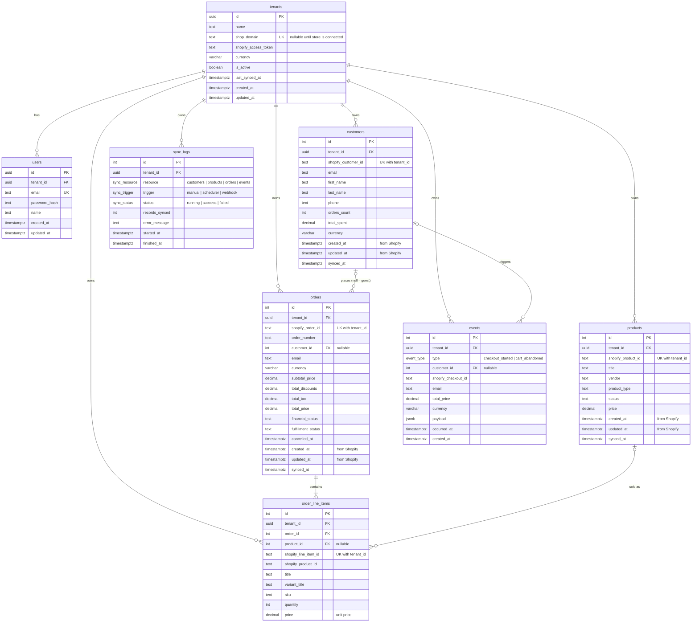

# Database schema

PostgreSQL, managed by Prisma. Source of truth: [`backend/prisma/schema.prisma`](../../backend/prisma/schema.prisma).
Migrations live in [`backend/prisma/migrations`](../../backend/prisma/migrations).

## ER diagram



## Tables

| Table | One row per | Notes |
|---|---|---|
| `tenants` | Retailer / Shopify store | `shop_domain` is unique; null until the store is connected |
| `users` | Dashboard login | Belongs to one tenant; `email` unique across the platform |
| `customers` | Shopify customer | Unique on `(tenant_id, shopify_customer_id)` |
| `products` | Shopify product | Unique on `(tenant_id, shopify_product_id)`; `price` is the lowest variant price |
| `orders` | Shopify order | Unique on `(tenant_id, shopify_order_id)`; `customer_id` null for guest checkout |
| `order_line_items` | Line in an order | Unique on `(tenant_id, shopify_line_item_id)` |
| `events` | Checkout started / cart abandoned | Unique on `(tenant_id, type, shopify_checkout_id)` so webhook retries don't duplicate |
| `sync_logs` | Sync run | What was synced, how it was triggered, how many records, success or error |

## Conventions

- **Naming:** tables and columns are `snake_case` in SQL (`orders.total_price`); Prisma exposes them as `camelCase` in JS (`order.totalPrice`).
- **Tenant isolation:** every Shopify-derived table has a `tenant_id` foreign key to `tenants`, and an index that starts with `tenant_id` (the composite unique keys double as that index). Every query in the app must filter by `tenant_id`.
- **No duplicates on re-sync:** the `(tenant_id, shopify_*_id)` unique keys let sync code upsert safely.
- **Money:** `DECIMAL(12,2)`, never floating point.
- **Time:** `TIMESTAMPTZ`. On Shopify tables `created_at` / `updated_at` are Shopify's values (when the order was really placed); `synced_at` is when we last wrote the row.
- **Shopify IDs** are stored as text: they are identifiers, not numbers.
- **Deletes:** deleting a tenant deletes all its data (`ON DELETE CASCADE`). Deleting a customer or product keeps orders and line items and sets the reference to `NULL`.

## Example queries

```sql
-- Total customers, orders and revenue for one tenant
SELECT
  (SELECT count(*) FROM customers WHERE tenant_id = $1) AS total_customers,
  (SELECT count(*) FROM orders    WHERE tenant_id = $1) AS total_orders,
  (SELECT coalesce(sum(total_price), 0) FROM orders WHERE tenant_id = $1) AS total_revenue;

-- Orders and revenue per day in a date range
SELECT date_trunc('day', created_at)::date AS day, count(*) AS orders, sum(total_price) AS revenue
FROM orders
WHERE tenant_id = $1 AND created_at >= $2 AND created_at < $3
GROUP BY day
ORDER BY day;

-- Top 5 customers by spend
SELECT c.first_name, c.last_name, c.email, sum(o.total_price) AS spend
FROM orders o
JOIN customers c ON c.id = o.customer_id
WHERE o.tenant_id = $1
GROUP BY c.id
ORDER BY spend DESC
LIMIT 5;
```

## Known limitations

- `orders.customer_id` (and the other in-tenant references) only checks that the row exists, not that it belongs to the same tenant. Enforcing that in SQL needs composite foreign keys on `(tenant_id, id)`, which can't be combined with `ON DELETE SET NULL` in Prisma. Tenant scoping is enforced in the application layer instead.
- `tenants.shopify_access_token` is stored as plain text for v1; it should be encrypted at rest before production.

## Working with the schema

```bash
cd backend
npx prisma migrate status                # which migrations are applied (read-only)
npx prisma migrate deploy                # apply committed migrations (use this on the shared DB)
npx prisma migrate dev --name <change>   # create a new migration after editing schema.prisma
npx prisma db seed                       # create the demo tenant (safe to re-run)
npx prisma studio                        # browse data in the browser
```
